<p align="center">
  
</p>

<p align="center">
  <b>Bring your app. Nexus handles the platform.</b><br>
  <sub>One config file and one command give any containerised app GitOps deployment, self-healing, observability and chaos testing on your own Kubernetes cluster.</sub>
</p>

<p align="center">
  <sub>
    <a href="https://kelyonn.github.io/nexus/">DOCUMENTATION</a> &nbsp;·&nbsp;
    <a href="#quick-start">QUICK START</a> &nbsp;·&nbsp;
    <a href="#how-it-works">HOW IT WORKS</a> &nbsp;·&nbsp;
    <a href="#a-tour">A TOUR</a> &nbsp;·&nbsp;
    <a href="#commands">COMMANDS</a> &nbsp;·&nbsp;
    <a href="#design-choices">DESIGN CHOICES</a>
  </sub>
</p>

<br>

<table>
  <tr>
    <td><sub>INSTALL</sub><br><code>pip install nexus-gitops</code></td>
    <td><sub>PYTHON</sub><br><b>3.10+</b></td>
    <td><sub>TESTS</sub><br><b>607, 99% core coverage</b></td>
    <td><sub>LICENSE</sub><br><b>Apache-2.0</b></td>
  </tr>
</table>

## Overview

Getting an app onto real Kubernetes usually means first becoming a Kubernetes expert. Nexus skips that step.

Point it at a containerised app, fill in `nexus.yaml`, and run `nexus deploy`. You get production-grade infrastructure in minutes, and nothing is a black box: every object Nexus creates is a standard Kubernetes resource you can read and edit.

<table>
  <tr>
    <td width="25%" valign="top"><b>GitOps</b><br><sub>Cluster state always comes from a git commit, through ArgoCD.</sub></td>
    <td width="25%" valign="top"><b>Self-healing</b><br><sub>Kubernetes replaces dead pods; ArgoCD reverts drift. Both run even if Nexus is gone.</sub></td>
    <td width="25%" valign="top"><b>Observability</b><br><sub>Prometheus and one Grafana dashboard per app.</sub></td>
    <td width="25%" valign="top"><b>Chaos</b><br><sub>Kill a pod on purpose with Chaos Mesh, and watch it recover.</sub></td>
  </tr>
</table>

## Quick start

Python 3.10+, Docker, and Minikube or Kind.

```bash
git clone https://github.com/kelyonn/nexus.git && cd nexus
python3 -m venv venv && source venv/bin/activate
pip install -e ".[dev]"
minikube start --driver=docker

cd examples/flask-demo
nexus deploy        # installs ArgoCD and monitoring, deploys the app
nexus open          # port-forward and open it
```

> [!TIP]
> For your own app, `pip install nexus-gitops`, then `nexus init` in its folder. It detects the stack and writes a pre-filled `nexus.yaml`.

```yaml
app:
  name: nexus-app
  image: kelyonnnn17/nexus-app:v1
  port: 5050
  healthPath: /healthz
  stack: flask
  replicas: 2
```

## How it works

<p align="center">
  
</p>

1. **Render.** `nexus.yaml` becomes Kubernetes manifests through Jinja2 templates.
2. **Install what is missing.** ArgoCD and kube-prometheus-stack, through `kubectl` and `helm`.
3. **Commit.** The manifests are committed to your repository under `k8s/`.
4. **Hand over.** An ArgoCD `Application` is registered to track that path.

From that point **ArgoCD owns reconciliation, not Nexus.** The dashboard is a separate, local, read-only layer.

## A tour

This is real, captured output, not a mock-up:

```
$ nexus deploy

  Nexus Deploy — nexus-app
  -------------------------------------------
  ✓ kubectl found (v1.36.2)
  ✓ helm found (v4.2.3)
  ✓ Cluster reachable -> minikube
  ✗ ArgoCD not installed → will install
  ✗ kube-prometheus-stack not installed → will install

  Deployment plan:
    1. Install ArgoCD → namespace: argocd
    2. Install kube-prometheus-stack → namespace: monitoring
    3. Apply app manifests → namespace: nexus-app
    4. Commit manifests to Git → k8s/
    5. Register ArgoCD app → tracking your repo @ main

  Proceed? [y/N]: y
  ...
  ✓ nexus-app is live
```

Then break it on purpose:

```bash
nexus status        # replicas, pods, ArgoCD sync and health
nexus chaos run     # kill a pod
nexus watch         # watch it come back
nexus destroy       # type the app name to confirm
```

### The dashboard

```bash
pip install -e ".[dashboard]"
nexus dashboard
```

An app grid, live CPU, memory, replica and restart sparklines, a chaos button with a recovery indicator, and a GitOps sync log with real commit messages. It ships as a static export inside the Python package, so there is no Node at install time.

## Commands

| Command | What it does |
|---|---|
| `nexus init` | Detect your stack, write `nexus.yaml` |
| `nexus deploy` | Install what is missing, apply, commit, register with ArgoCD |
| `nexus status` | Replicas, sync and health, pods |
| `nexus open` | Port-forward and open the app until Ctrl+C |
| `nexus watch` | Stream pod lifecycle events |
| `nexus logs` | Every pod's logs, prefixed by pod name |
| `nexus doctor` | Every environment problem, each with its fix |
| `nexus upgrade --image` | Bump the image, commit, roll out |
| `nexus rollback` | Revert the image through git |
| `nexus destroy` | Remove everything, after a typed confirmation |
| `nexus chaos run` · `chaos schedule` | One-off or recurring pod kills |
| `nexus dashboard` | The local control panel |

Every flag, straight from `--help`, is in the [command reference](https://kelyonn.github.io/nexus/commands/).

## Design choices

> [!NOTE]
> **Rollback goes through git, never ArgoCD's own rollback.** Self-heal would immediately undo a rollback that git does not agree with.

- **`deploy` never leaves a tunnel running.** A background port-forward would collide with your next deploy, so viewing the app is its own command.
- **Grafana is linked, not embedded.** An embedded unauthenticated Grafana silently shows its login form, so the dashboard links straight to the app's panel and prints the admin login.
- **Idempotent by default.** Running `deploy` twice is safe.

## Documentation

| | |
|---|---|
| [Install and quickstart](https://kelyonn.github.io/nexus/install/) | A real app on Minikube or Kind in ten minutes |
| [`nexus.yaml` schema](https://kelyonn.github.io/nexus/schema/) | Every field, default and rule |
| [Architecture](https://kelyonn.github.io/nexus/architecture/) | How the pieces connect |
| [Exposing your app](https://kelyonn.github.io/nexus/exposing-your-app/) | Port-forward, `serviceType`, or your own Ingress |
| [Multiple environments](https://kelyonn.github.io/nexus/multi-environment/) | Staging and production |
| [Troubleshooting](https://kelyonn.github.io/nexus/troubleshooting/) | Real problems and their fixes |
| [Cloud quick-starts](https://kelyonn.github.io/nexus/cloud/) | EKS, GKE and AKS notes, not yet verified on real clusters |

Contributions are welcome: see [CONTRIBUTING.md](CONTRIBUTING.md), and [FUTURE-SCOPE.md](FUTURE-SCOPE.md) for ideas that are real but deliberately not started.

<sub>Apache-2.0.</sub>
